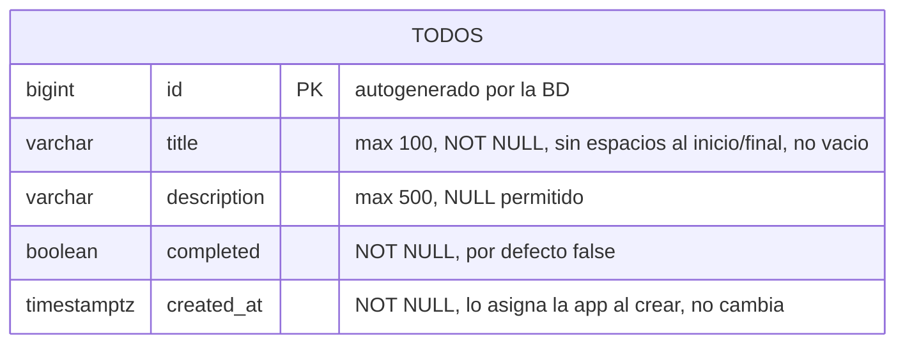

# Modelo de datos — API de Tareas (Todos)

Basado en [SPECS.md](../../SPECS.md) (secciones 3 y 11).

## 1. Diagrama entidad-relación

El modelo tiene **una sola entidad** y, por tanto, **no hay relaciones** ni claves foráneas. Usuarios y categorías quedan fuera de alcance (SPECS §11).

**Dueño de la fila:** ningún usuario. En el MVP no hay login, así que todas las filas de `todos` pertenecen a **la aplicación**: hay una sola lista compartida y cualquier cliente de la API puede leer y modificar cualquier tarea. Cuando se agreguen usuarios, la tabla tendrá una columna `user_id` (FK) que indique el dueño (ver §5).

## 2. Diccionario de datos

| Columna       | Tipo           | Nulo | Por defecto  | Reglas (SPECS §3) |
|---------------|----------------|------|--------------|-------------------|
| `id`          | `BIGINT`       | No   | autoincremental | Clave primaria, única, la asigna la BD, nunca cambia (reglas 3, 4, 7) |
| `title`       | `VARCHAR(100)` | No   | —            | Se recorta (*trim*) antes de validar; 1–100 caracteres; se permiten repetidos (reglas 1, 2) |
| `description` | `VARCHAR(500)` | Sí   | `NULL`       | Máx. 500 caracteres (regla 2) |
| `completed`   | `BOOLEAN`      | No   | `false`      | Siempre `true` o `false` (regla 6) |
| `created_at`  | `TIMESTAMPTZ`  | No   | — (lo asigna la app al crear) | No se actualiza nunca; nunca es futura (reglas 4, 5) |

**Nombres en la BD y en la API:** en la base de datos las columnas usan `snake_case` (`created_at`) y en el JSON de la API usan `camelCase` (`createdAt`). Es el mismo dato con otro nombre.

**Reglas que no son de datos:** la regla 8 (no guardar nada a medias) se cumple validando todo antes de escribir y usando una transacción por operación. La regla 10 (formato de errores) es solo de la API y no afecta al modelo.

### Datos de ejemplo (SPECS §8)

| id | title | description | completed |
|----|-------|-------------|-----------|
| 1 | Estudiar Spring Boot | Repasar controladores y JPA | false |
| 2 | Hacer el laboratorio | Modelo de datos en Mermaid | true |
| 3 | Desplegar en Render | — | false |

## 3. Entrevista de datos (preguntas y decisiones)

| # | Pregunta | Decisión | Motivo |
|---|----------|----------|--------|
| 1 | ¿Cómo se llama la tabla? | `todos` (plural, minúsculas, `snake_case`) | Convención habitual en SQL |
| 2 | ¿Qué tipo de id? ¿Número o UUID? | `BIGINT` autoincremental | Más simple de leer y probar (`/api/todos/1`) |
| 3 | ¿El título puede repetirse? | Sí, sin restricción `UNIQUE` | Decisión tomada en las specs |
| 4 | ¿La descripción vacía se guarda como `""` o `NULL`? | `NULL` | Un único valor para decir "sin descripción" |
| 5 | ¿Guardamos `updated_at`? | No | No lo piden las specs; se puede agregar después |
| 6 | ¿Borrado físico o lógico (`deleted = true`)? | Físico | Coincide con la regla 9: una tarea borrada ya no existe y devuelve `404` |
| 7 | ¿Índices extra (por ejemplo, en `completed`)? | No, solo la clave primaria | Con pocos datos no hace falta |
| 8 | ¿Zona horaria de `created_at`? | Con zona horaria: `timestamptz` en la BD y `OffsetDateTime` en Java | El servidor de Render corre en UTC y el usuario está en Colombia (UTC-5); sin zona la hora sería ambigua |
| 9 | ¿Qué valida la BD y qué valida la app? | La BD garantiza `NOT NULL`, longitudes y PK. La app garantiza el *trim*, el título no vacío, que `created_at` se asigne una sola vez con la hora actual (nunca futura) y que no cambie | Defensa en dos capas |
| 10 | ¿Quién asigna `created_at`, la BD o la app? | La app, en el momento de crear la tarea | Las specs dicen que lo asigna el servidor; así hay una sola fuente de la verdad |
| 11 | ¿Quién es el dueño de cada fila? | La aplicación (lista única compartida) | No hay usuarios en el MVP (SPECS §11) |
| 12 | ¿Qué reglas "no puede haber dos…" necesitan `UNIQUE`? | Solo "dos tareas con el mismo `id`", que ya cubre la PK | Los títulos repetidos están permitidos |

## 4. Revisión con el checklist del interventor

| # | Punto del checklist | Resultado | Corrección / evidencia |
|---|---------------------|-----------|------------------------|
| 1 | Cada entidad tiene `id` y `created_at` | Pasa | `todos` tiene ambos (§1) |
| 2 | Toda relación tiene clave foránea | Pasa (no aplica) | No hay relaciones en el MVP |
| 3 | Toda regla "no puede haber dos…" tiene un `UNIQUE` | Pasa | La única es "dos tareas con el mismo `id`" y la cubre la PK (pregunta 12) |
| 4 | Tipos con sentido: fechas como `date`/`timestamptz`, dinero como entero en pesos | **No pasaba** | `created_at` era `TIMESTAMP` sin zona; ahora es `timestamptz` (pregunta 8). No hay dinero |
| 5 | No hay campos que ninguna spec use | Pasa | Los 5 campos salen de SPECS §3 |
| 6 | Cada tabla dice quién es el dueño de la fila | **No pasaba** | Se agregó "Dueño de la fila" en §1 (pregunta 11) |
| 7 | Cada acción de las pantallas tiene su operación en el contrato | **No pasaba** | Se agregó la tabla "Acciones → operaciones" en [docs/contratos/api.md](../contratos/api.md) §2 |
| 8 | Cada operación lista sus errores con código HTTP y mensaje | **No pasaba** | Cada operación de [docs/contratos/api.md](../contratos/api.md) tiene su tabla de errores |

Todos los puntos pasan después de las correcciones.

## 5. Mejoras para el futuro (fuera del MVP)

- Entidad `USUARIOS` con relación 1:N hacia `TODOS` (un usuario tiene muchas tareas).
- Columna `updated_at`.

## 6. Implementación en la base de datos

El modelo está implementado en PostgreSQL de Supabase con la migración [supabase/migrations/20261120000000_crear_tabla_todos.sql](../../supabase/migrations/20261120000000_crear_tabla_todos.sql):

- Reglas 1 y 2 → `NOT NULL`, `VARCHAR(100)`/`VARCHAR(500)` y los `CHECK` `todos_title_no_vacio`, `todos_title_recortado` y `todos_description_no_vacia`.
- Reglas 3, 4 y 7 → `id` `GENERATED ALWAYS AS IDENTITY`: la BD rechaza un id enviado y cualquier cambio del id.
- Reglas 4 y 5 → trigger `todos_proteger_created_at`: rechaza fechas futuras y cambios de `created_at`.
- Dueño de la fila → RLS activado sin políticas y sin permisos para `anon` y `authenticated`. Solo el backend (dueño de la tabla) puede leer y escribir.
